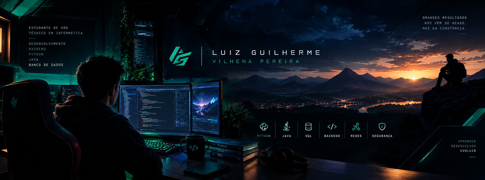

---

### 👨‍💻 Sobre mim

Sou **Luiz Guilherme**, estudante de **Análise e Desenvolvimento de Sistemas na UNA** e **Técnico em Informática pelo SENAC**.

Tenho interesse em **desenvolvimento de software, redes, infraestrutura, suporte técnico e cibersegurança**, buscando transformar o que aprendo em projetos práticos.

Atualmente, estou aprofundando meus conhecimentos em **backend com Python e APIs** e comecei um curso de **banco de dados com duração de três semanas**, estudando modelagem relacional e organização dos dados.

---

<h3 align="left">🎯 Objetivo</h3>

Busco uma oportunidade de **estágio ou posição de nível inicial em Tecnologia da Informação**, com o objetivo de aplicar meus conhecimentos, desenvolver novas competências e adquirir experiência profissional.

---

<h3 align="left">📚 Formação</h3>

- 🎓 **Análise e Desenvolvimento de Sistemas** — UNA Pouso Alegre *(em andamento)*
- 💻 **Técnico em Informática** — SENAC Pouso Alegre *(em andamento)*
- 🎓 **Ensino Médio Completo** — Escola Estadual Virgília Paschoal *(2022)*

---

<h3 align="left">🚀 Projetos</h3>

- 🎮 **Delta Trigger** — RPG textual desenvolvido em Java, com personagens, combates, habilidades, itens e missões.
- 💰 **Passaporte dos 12 Salários** — projeto em desenvolvimento voltado ao acompanhamento de metas financeiras mensais, com interface, check-ins e conquistas; o backend e o login estão previstos para etapas futuras.
- ⚙️ **Todo List API** — backend acadêmico em Python com FastAPI, cadastro e autenticação de usuários, gerenciamento de tarefas e camada de persistência com SQLAlchemy.
- 🚌 **Expresso Planalto** — conceito de aplicação para facilitar o acesso a horários, informações e notícias do transporte público.
- 🌐 **Conecta PA** — projeto para reunir e divulgar informações sobre ONGs de Pouso Alegre.
- 🔐 **Projeto de Redes e Cibersegurança** — atividades acadêmicas envolvendo estrutura de rede, organização de IPs e segurança digital.
- 🖥️ **Infraestrutura da APAC** — atividades de manutenção, limpeza, formatação e configuração de computadores.
- 🎮 **Projetos de jogos** — experiências com desenvolvimento de jogos e ferramentas como Construct.

---

<h3 align="left">🛠️ Tecnologias e ferramentas</h3>

 

**Também:** SQLAlchemy • FastAPI • Uvicorn • Redes de computadores • Suporte técnico • Manutenção de computadores • Cibersegurança • Figma • Construct • Photoshop

---

<h3 align="left">📫 Conecte-se comigo</h3>

---

### 📊 GitHub Stats

---

### 📖 Atualmente estudando

- Backend com Python e FastAPI
- APIs REST e organização por camadas
- Banco de dados relacionais e modelagem: tabelas, tipos de dados, chaves primárias e estrangeiras, relacionamentos, normalização e documentação
- Programação Orientada a Objetos
- Desenvolvimento Web

---

### 🐍 Minhas contribuições

<picture>
  <source media="(prefers-color-scheme: dark)" srcset="https://raw.githubusercontent.com/Guivilhena2005/Guivilhena2005/output/github-contribution-grid-snake-dark.svg">
  <source media="(prefers-color-scheme: light)" srcset="https://raw.githubusercontent.com/Guivilhena2005/Guivilhena2005/output/github-contribution-grid-snake.svg">
  
</picture>

---

💻 **Sempre aprendendo, desenvolvendo e evoluindo.**

